# Installation et configuration de GLPI Agent sur un poste client Debian

> État documentaire au 24 octobre 2026 : procédure de laboratoire et captures historiques conservées. Le projet EcoTech est une simulation. Ces traces ne certifient ni la disponibilité actuelle du service, ni un déploiement en production. Les commandes décrivent le travail documenté ; elles ne constituent pas un script de réinstallation validé.
> La remontée du client Debian est visible dans l’entité racine. Le rattachement de ce client à EcoTech et la continuité avec les neuf équipements simulés ne sont pas établis par les captures. L’adresse 192.168.1.34 est celle du laboratoire au moment des essais ; la vérifier avant réutilisation.

## 1. Présentation du projet

Ce mini-projet consiste à inventorier automatiquement un poste client Debian dans un serveur GLPI à l’aide de **GLPI Agent**.

Le serveur GLPI reçoit les informations envoyées par l’agent installé sur le poste client. Ces informations permettent d’identifier le poste, ses logiciels et ses composants matériels.

---

## 2. Architecture utilisée

Deux machines virtuelles ont été utilisées :

```text
VM 1 : Serveur GLPI
Rôle : recevoir les inventaires
Système : Debian 11
Application : GLPI

VM 2 : Poste client
Rôle : envoyer son inventaire au serveur GLPI
Système : Debian 11
Application : GLPI Agent
```

Schéma de fonctionnement :

```text
Poste client Debian → GLPI Agent → Serveur GLPI → Parc informatique
```

---

## 3. Configuration réseau de la VM serveur GLPI

La VM serveur GLPI a été configurée en **accès par pont** dans VirtualBox.

Ce mode permet à la VM d’être présente sur le même réseau que le PC hôte et que la VM cliente.

Preuve :

```text
../preuves/inventaire-agent/01-reseau-vm-serveur-glpi.png
```

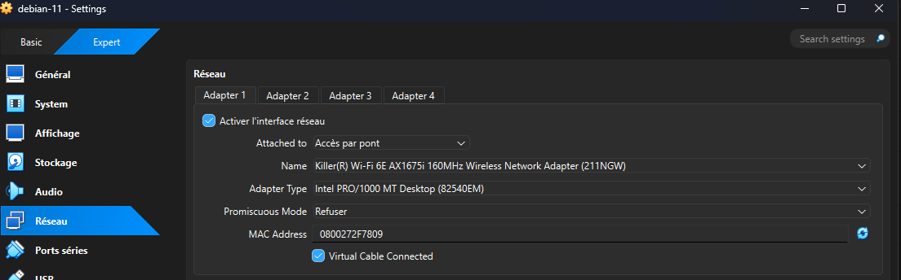

---

## 4. Création et configuration réseau de la VM cliente

Une deuxième machine virtuelle Debian 11 a été créée pour jouer le rôle de poste client.

Configuration utilisée :

```text
Nom : Debian-Client-GLPI-Agent
Système : Debian 11
Mémoire : 2048 Mo
Processeur : 1 CPU
Disque dur : 20 Go
Réseau : accès par pont
```

Cette VM ne contient pas GLPI serveur. Elle sert uniquement de poste client avec GLPI Agent.

Preuve :

```text
../preuves/inventaire-agent/02-creation&reseau-vm-client.png
```

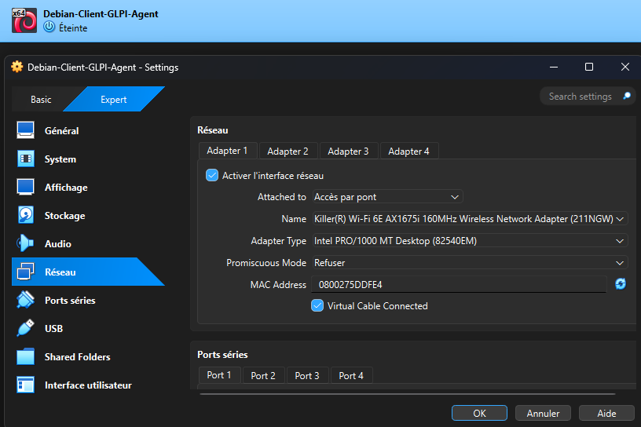

---

## 5. Récupération de l’adresse IP du serveur GLPI

Sur la VM serveur GLPI, la commande suivante a été utilisée :

```bash
hostname -I
```

Cette commande permet d’obtenir l’adresse IP du serveur GLPI.

Adresse IP utilisée pour le projet :

```text
192.168.1.34
```

Cette adresse est importante, car elle permet au poste client d’envoyer son inventaire vers le serveur GLPI.

Preuve :

```text
../preuves/inventaire-agent/03-ip-serveur-glpi.png
```

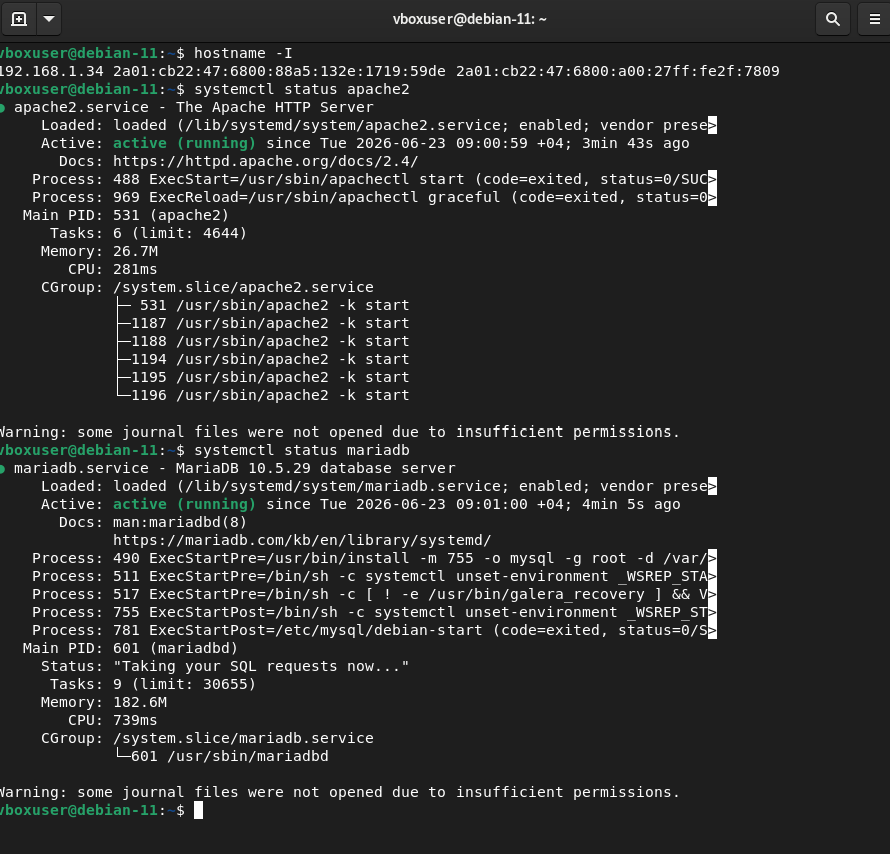

---

## 6. Test de communication entre le client et le serveur

Depuis la VM cliente Debian, la communication avec le serveur GLPI a été testée avec la commande :

```bash
ping -c 4 192.168.1.34
```

Explication :

* `ping` permet de tester la communication réseau ;
* `-c 4` permet d’envoyer seulement 4 paquets ;
* `192.168.1.34` correspond à l’adresse IP du serveur GLPI.

Ce test permet de vérifier que les deux VM peuvent communiquer entre elles.

Preuve :

```text
../preuves/inventaire-agent/04-ping-client-vers-serveur.png
```

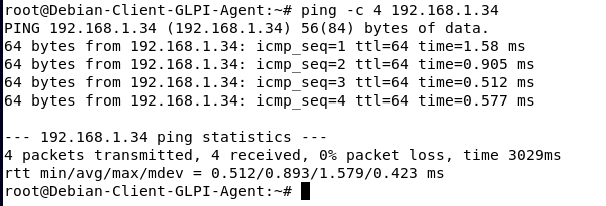

---

## 7. Activation de l’inventaire dans GLPI

Dans l’interface GLPI, l’inventaire a été activé depuis le menu :

```text
Administration → Inventaire
```

Cette étape permet au serveur GLPI d’accepter les inventaires envoyés par les agents.

Preuve :

```text
../preuves/inventaire-agent/05-activation-inventaire-glpi.png
```

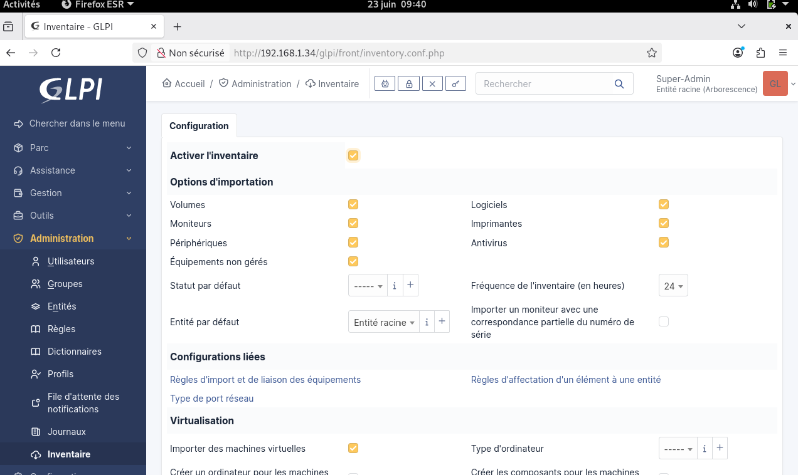

---

## 8. Installation de GLPI Agent sur le poste client

Sur la VM cliente Debian, les paquets nécessaires ont été installés :

```bash
apt update
apt install -y wget perl ca-certificates dmidecode pciutils
```

Ensuite, l’installateur GLPI Agent a été téléchargé dans le dossier `/tmp` :

```bash
cd /tmp
wget https://github.com/glpi-project/glpi-agent/releases/download/1.16/glpi-agent-1.16-linux-installer.pl
```

L’installation a été lancée avec la commande :

```bash
perl glpi-agent-1.16-linux-installer.pl
```

Pendant l’installation, l’adresse du serveur GLPI a été renseignée :

```text
http://192.168.1.34/glpi/front/inventory.php
```

Cette URL correspond au point d’entrée utilisé par GLPI pour recevoir les inventaires.

Preuve :

```text
../preuves/inventaire-agent/06-installation-glpi-agent.png
```

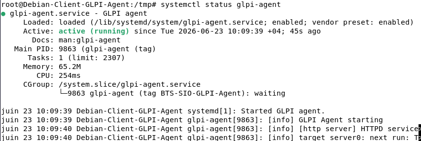

---

## 9. Accès à l’interface locale de GLPI Agent

Après l’installation, l’interface locale de GLPI Agent a été ouverte depuis le navigateur de la VM cliente à l’adresse :

```text
http://localhost:62354
```

Cette interface permet de vérifier que l’agent fonctionne correctement.

Le statut affiché indique que GLPI Agent est en attente de la prochaine exécution d’inventaire.

Preuve :

```text
../preuves/inventaire-agent/07-interface-locale-agent.png
```

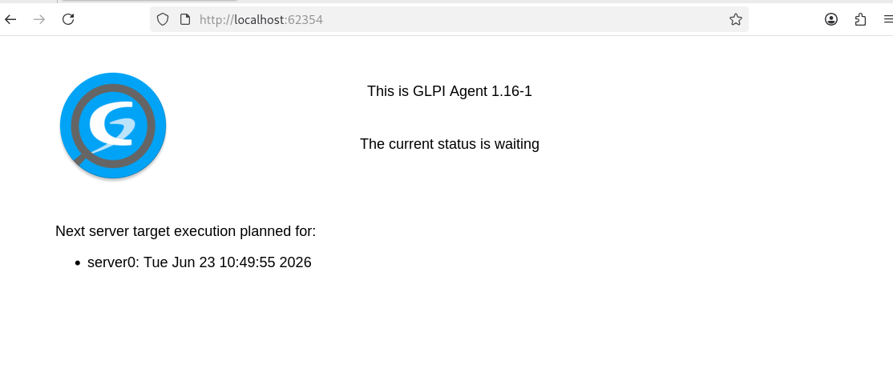

---

## 10. Forçage d’un inventaire

Un inventaire a été forcé afin d’envoyer immédiatement les informations du poste client au serveur GLPI.

Commande utilisée :

```bash
glpi-agent --force
```

Commande alternative avec affichage détaillé :

```bash
glpi-agent --server http://192.168.1.34/glpi/front/inventory.php --force --debug
```

Cette étape permet de déclencher manuellement la remontée du poste client dans GLPI.

Preuve :

```text
../preuves/inventaire-agent/08-force-inventory.png
```

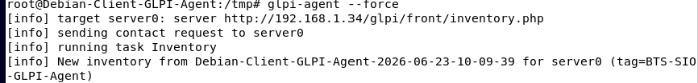

---

## 11. Vérification du poste détecté dans GLPI

Après l’envoi de l’inventaire, le poste client a été vérifié dans GLPI depuis le menu :

```text
Parc → Ordinateurs
```

Le poste client Debian apparaît bien dans la liste des ordinateurs inventoriés.

Cette capture est une preuve essentielle du projet, car elle montre que l’inventaire automatique fonctionne.

Preuve :

```text
../preuves/inventaire-agent/09-poste-detecte-dans-glpi.png
```

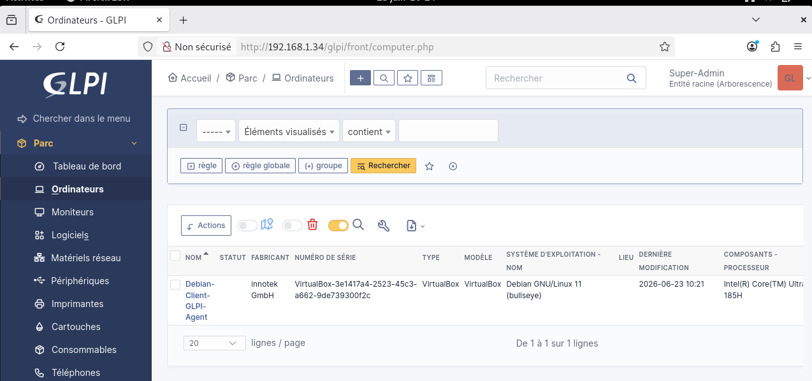

---

## 12. Consultation des logiciels détectés

Dans GLPI, les logiciels détectés sur le poste client ont été consultés depuis la fiche de l’ordinateur.

Cette étape montre que GLPI Agent ne remonte pas seulement le nom du poste, mais aussi des informations logicielles.

Preuve :

```text
../preuves/inventaire-agent/10-logiciels-detectes.png
```

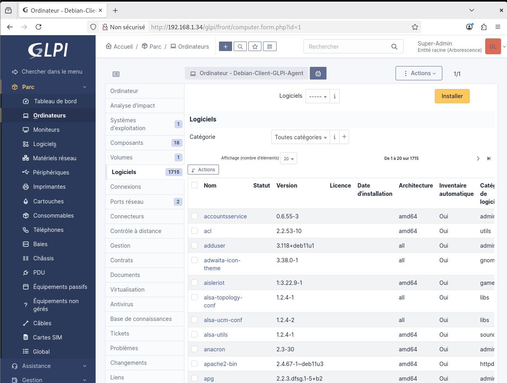

---

## 13. Consultation des composants détectés

Les composants matériels détectés ont également été consultés dans GLPI.

Cette étape permet de vérifier la remontée d’informations matérielles telles que :

* processeur ;
* mémoire ;
* disque ;
* carte réseau ;
* système.

Preuve :

```text
../preuves/inventaire-agent/11-composants-detectes.png
```

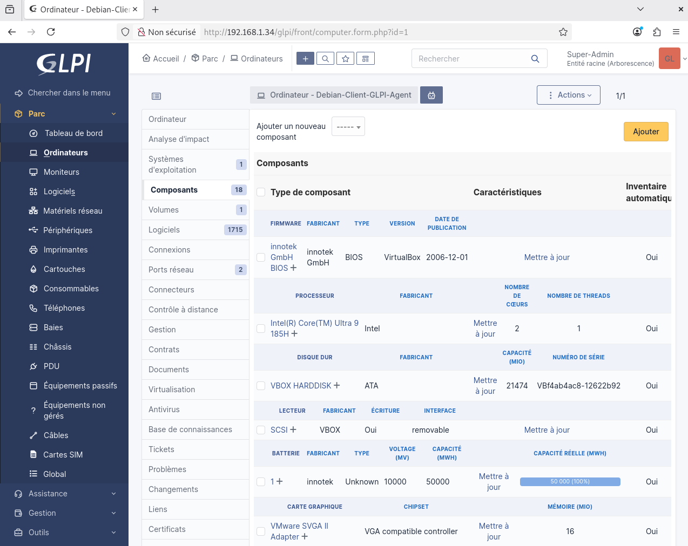

---

## 14. Difficultés rencontrées

### Erreur avec la commande ping

Au départ, la commande suivante était incorrecte :

```bash
ping -c 192.168.1.34
```

Le problème venait du fait que l’option `-c` attend un nombre de paquets.

Commande correcte :

```bash
ping -c 4 192.168.1.34
```

---

### Erreur lors du lancement de l’installateur

L’installateur GLPI Agent avait bien été téléchargé, mais la commande d’exécution devait être lancée correctement avec Perl :

```bash
perl glpi-agent-1.16-linux-installer.pl
```

---

## 15. Ce qu’il faut retenir

GLPI Agent est installé sur le poste client. Il collecte les informations de la machine, puis les envoie vers le serveur GLPI.

Le serveur GLPI centralise ensuite ces informations dans son parc informatique.

La logique du projet est donc :

```text
Client Debian → GLPI Agent → Serveur GLPI → Parc informatique
```

---

## 16. Conclusion

Ce projet m’a permis de comprendre le fonctionnement d’un inventaire automatisé avec GLPI.

J’ai appris à :

* créer un poste client séparé du serveur ;
* configurer deux VM sur le même réseau ;
* tester la communication entre deux machines ;
* installer GLPI Agent ;
* configurer l’adresse du serveur GLPI ;
* accéder à l’interface locale de l’agent ;
* forcer un inventaire ;
* vérifier la remontée du poste dans GLPI ;
* consulter les logiciels et composants détectés.

Ce mini-projet correspond à une situation professionnelle de gestion de parc informatique avec inventaire automatique.
