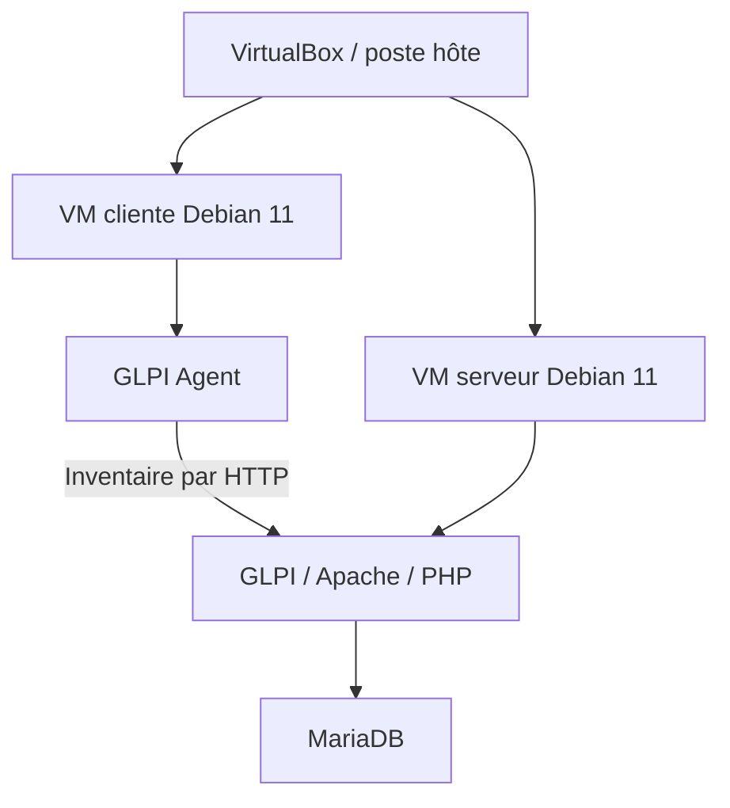

# Cartographie du laboratoire et du scénario EcoTech

## Architecture technique documentée

La procédure agent décrit deux interfaces en accès par pont et l’adresse historique du serveur `192.168.1.34`. Le client est visible dans l’entité racine. Le rattachement à EcoTech et la continuité entre les différentes séries de captures ne sont pas démontrés.

## Organisation représentée dans GLPI

L’entité EcoTech regroupe les neuf fiches du [parc simulé](inventaire-parc.md) et les [tickets](gestion-des-tickets.md). Le scénario comprend quatre ordinateurs, trois téléphones, une imprimante et une Livebox.

Google Drive et les documents de chantier apparaissent dans les demandes de support. Le dépôt ne démontre pas une intégration automatique à ces services ni une topologie physique vérifiée dans l’entreprise.

Les anciens schémas de cadrage restent disponibles comme [preuves documentaires historiques](preuves/documentation/README.md). En cas de différence de quantités ou de noms, les listes capturées dans GLPI et les registres actuels du dépôt constituent la référence du scénario réalisé.
